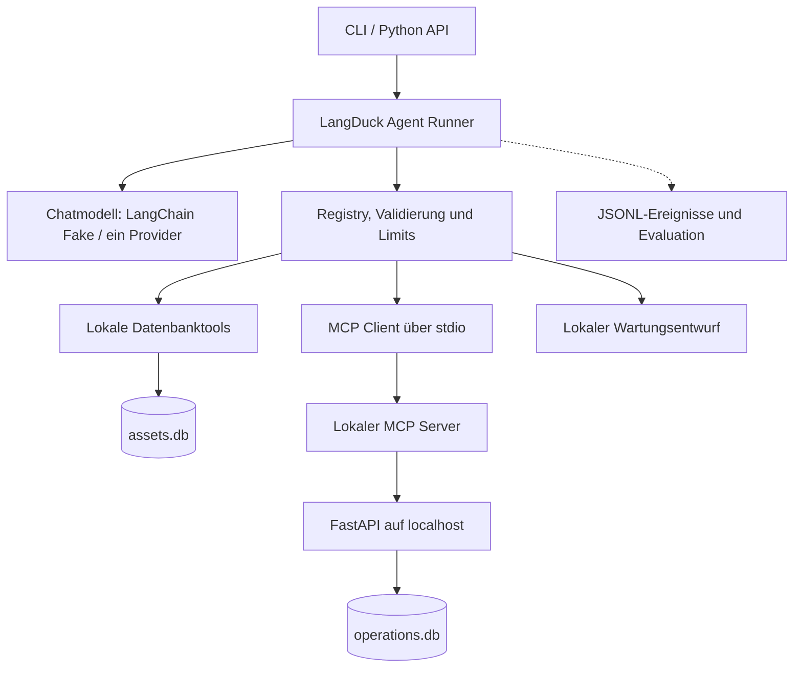
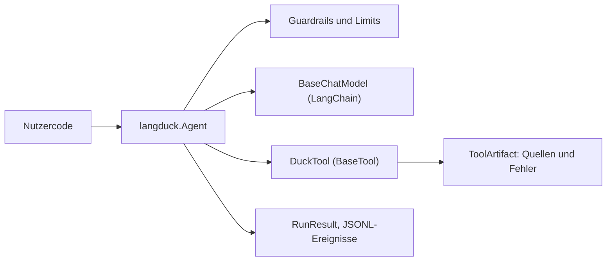
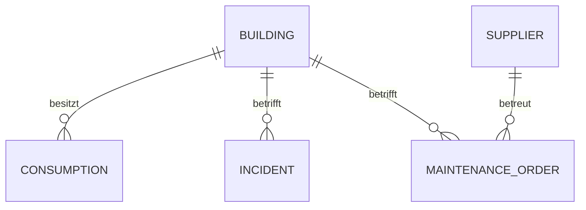
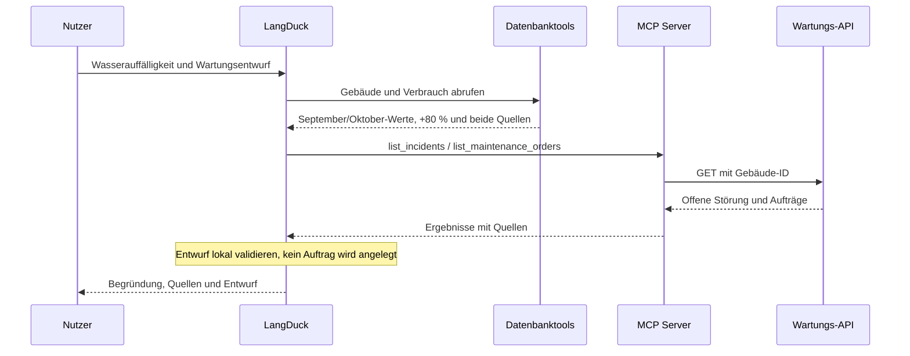
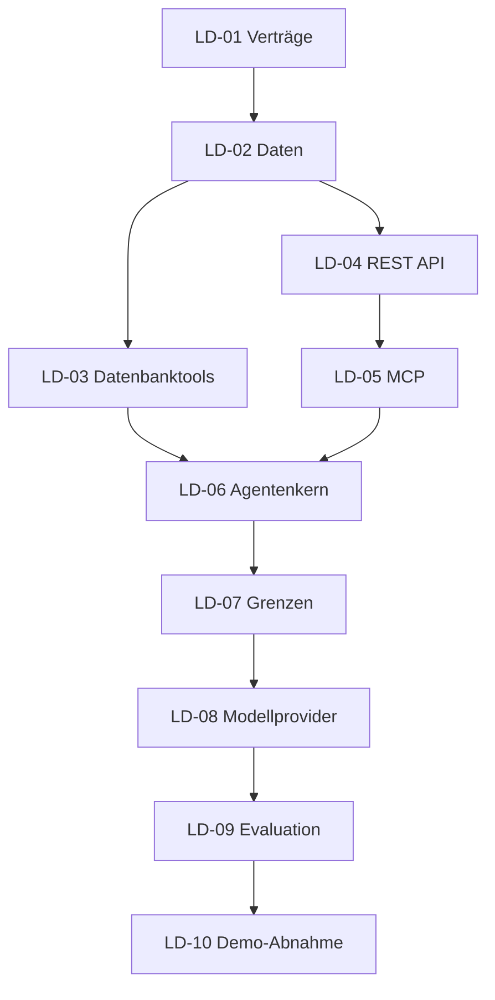
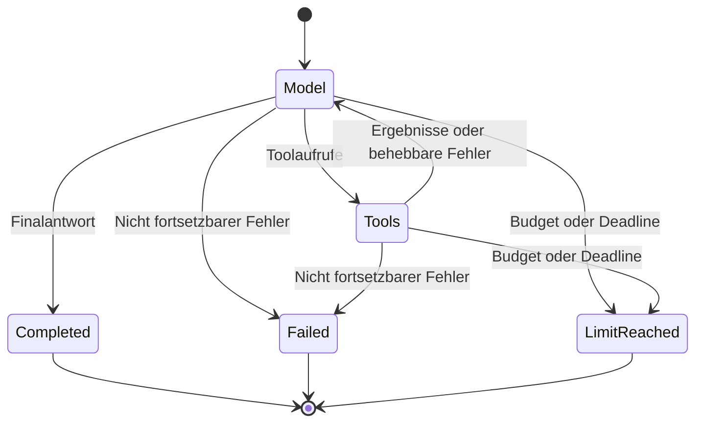

# DuckOps Entenhausen – Projektplan für LangDuck

Stand: 11. November 2026. Status: Planung, keine implementierten Funktionen.
Tracking: [Epic #2](https://github.com/nakicam/LangDuck/issues/2).

## Ziel und Referenzdemo

LangDuck erhält einen kleinen Python-Agentenkern, der von Anfang an auf langchain-core aufbaut: Nachrichten, Toolaufrufe, Tools (`BaseTool`) und Chatmodelle (`BaseChatModel`) kommen aus LangChain. LangDuck ergänzt Ausführungsloop, Grenzen, Status, Quellen und Entwürfe. LangGraph ist nicht Teil des Kerns. Die fiktive Stadtwerke-Demo DuckOps bleibt vom Framework getrennt.

Referenzauftrag: **„Finde den erhöhten Wasserverbrauch im Entenbad, prüfe die offenen Störungen und erstelle einen begründeten Wartungsentwurf.“**

Der Agent liest Verbrauch über Datenbanktools, korreliert eine Störung über MCP und REST und liefert einen lokal erzeugten Entwurf mit Zahlen und Quellen. Er legt keinen echten Wartungsauftrag an.

## Architektur



| Modul | MVP-Verantwortung |
| --- | --- |
| langduck.agents | `Agent`-Klasse (Komposition um ein LangChain-Chatmodell) und eigener Ausführungsloop |
| langduck.models | Fake-Chatmodell (LangChain) und ein echtes LangChain-Chatmodell mit Providerpaket |
| langduck.tools | `duck_tool`-Dekorator und `DuckTool` (Subklasse von `BaseTool`) mit Schema-Prüfung, Registry und Quellen-IDs als Artifact |
| langduck.guardrails | Allowlist, Grenzen, Deadline und Eingabevalidierung |
| langduck.memory | Nachrichten und Toolergebnisse eines Laufs, nur im Speicher |
| langduck.observability | Strukturierte JSONL-Ereignisse |
| langduck.evaluation | Offline-Tests und getrennte fachliche Live-Evaluation |
| langduck.flows | Nach MVP, noch keine Umsetzung |

Vorgeschlagene Ablage: src/langduck/ für Frameworkcode, examples/duckops/ für Generator, Datenzugriff, API, MCP Server und CLI, tests/ für deterministische Tests, evals/duckops/ für Aufgaben und Ground Truth, docs/ für Architektur und Anleitung. Generierte Datenbanken und Logs gehören in ignorierte Laufzeitverzeichnisse.

## LangDuck als dünne Schicht über LangChain

LangDuck ersetzt LangChain nicht, sondern gibt ihm einen kleinen, sicherheitsbewussten Rahmen. Entscheidung: **Komposition mit eigenen Klassen** statt Wrapper-Funktionen um alles oder Vererbung von Modellklassen.

| Baustein | Form | Begründung |
| --- | --- | --- |
| `Agent` | Eigene Klasse; hält ein beliebiges `BaseChatModel`, Tools und `RunConfig`; `run(frage) -> RunResult` | Modell bleibt austauschbar, Loop und Grenzen gehören LangDuck |
| `DuckTool` / `@duck_tool` | Subklasse von `BaseTool` beziehungsweise Dekorator um LangChains `tool` | Erzwingt `content_and_artifact`, Quellen-IDs, Fehlerklassifikation und Timeout |
| `Guardrails` | Eigene Klasse; Allowlist, Limits, Deadline | LangChain bringt dies nicht mit |
| Ereignisse | Eigene Klasse, schreibt JSONL | Pro Run genau ein Abschlussereignis |
| Modelle | Keine Subklasse, nur Parameter | Jedes LangChain-Chatmodell funktioniert, Fake-Modell für Offline-Läufe |

Geplante öffentliche API, Entwurf (noch nicht implementiert):

```python
agent = Agent(model=chat_model, tools=[list_buildings, get_consumption], config=RunConfig())
result = agent.run("Finde den erhöhten Wasserverbrauch im Entenbad ...")
```



Regeln: Kein LangChain-Code wird kopiert oder umgeschrieben. Eigene Klassen enthalten nur, was LangChain nicht liefert. Die Schicht bleibt über LangChain-Typen austauschbar; LangGraph kann später ersetzend oder vergleichend daneben stehen.

## Verträge und Ausführungsregeln

- Agent arbeitet mit LangChain-Typen: `AIMessage`, `ToolMessage`, `BaseTool` und `BaseChatModel`; Toolaufrufe sind LangChain-`ToolCall` (name, args, id). LangDuck definiert zusätzlich RunConfig, RunResult, RunStatus, RunError, SourceRef, ToolArtifact und MaintenanceDraft in `langduck/types.py`. Keine generische Kompatibilitätsplattform.
- Tools sind LangChain-Tools mit `response_format="content_and_artifact"`: der Text geht ans Modell, das `ToolArtifact` (Quellen-IDs, Fehlerklassifikation) bleibt maschinenlesbar in `ToolMessage.artifact`. Fehlerstatus bleibt definiert (`ToolMessage.status`).
- Der Loop ist eigener LangDuck-Code. Chatmodelle werden über LangChain angebunden (Abhängigkeit `langchain-core` plus ein Providerpaket für LD-08, Version pinnen); für Offline-Läufe dient ein LangChain-Fake-Chatmodell.
- RunResult enthält Antwort, Status, Schrittzahl, Fehler, vorhandene Nutzungsdaten und den letzten validierten strukturierten Wartungsentwurf. Draft: building_id, title, priority, rationale, source_ids und draft=true; keine Persistenz.
- Status: completed, failed oder limit_reached. Mehrere Aufrufe pro Modellrunde werden sequenziell abgearbeitet.
- Standard: maximal 5 Modellrunden, 10 Toolaufrufe und 60 Sekunden Gesamtlaufzeit. I/O benötigt eigene Timeouts; blockierte Aufrufe müssen sauber beendet beziehungsweise ihre Prozesse geschlossen werden.
- Keine automatischen Retries im MVP, einschließlich deaktivierter SDK-Retries. Fehlerbehandlung bleibt nachvollziehbar und innerhalb der Grenzen.
- MCP: ein lokaler Server, stdio, SDK-gesteuerter Lebenszyklus der ausdrücklich getesteten und gepinnten Protokollrevision sowie Tool-Discovery; nur zwei explizit erlaubte Tools. Schemas werden validiert, Namen kollisionsfrei zugeordnet. Protokolldaten auf stdout, Diagnose auf stderr.
- Toolinhalte sind Daten und vergeben keine Berechtigungen. Die Allowlist ersetzt keine allgemeine Absicherung gegen alle Prompt-Injection-Angriffe.

## Datenmodell und Testdaten

Alle Daten sind synthetisch. Seed 42 und Referenzdatum 2026-11-01 sind festgelegt. Datenfenster: November 2025 bis Oktober 2026.

| Entität | Anzahl | Wesentliche Felder |
| --- | ---: | --- |
| Gebäude | 20 | id, name, type |
| Verbrauch | 720 | id, building_id, month, metric, value, unit |
| Dienstleister | 10 | id, name, trade |
| Wartungsauftrag | 100 | id, building_id, supplier_id, status, priority, due_date, description |
| Störung | 30 | id, building_id, status, reported_at, description |

720 Verbrauchswerte = 20 Gebäude × 12 Monate × 3 Metriken. Einheiten: Strom/Wärme in kWh, Wasser in m³. Assets und Verbrauch liegen in assets.db; Betriebsdaten in operations.db. Gemeinsame Gebäude-IDs werden vom Generator geprüft; es gibt keine datenbankübergreifenden Foreign Keys.

Logische Beziehungen; keine datenbankübergreifenden Foreign Keys.



Bewusst eingebaute Fälle:
1. Entenbad: September 100 m³, Oktober 180 m³, damit +80 %; beide Quellen-IDs werden geprüft.
2. Offene Leckmeldung am selben Gebäude: mögliche Erklärung, kein Beweis für die Ursache.
3. Überfälliger dringender Heizungsauftrag.
4. Zwei inhaltlich doppelte Wartungsaufträge innerhalb der insgesamt 100 Aufträge. Überfälligkeit: unerledigter Status und due_date vor 2026-11-01.

Ein getrenntes Ground-Truth-Manifest beschreibt erwartete IDs und Werte; der Agent erhält keinen Zugriff darauf. Auch Beschreibungen mit irreführenden Anweisungen werden als Fehlerfall getestet.

## Tools und API

| Tool | Zugang | Wesentliche Eingaben | Ergebnis |
| --- | --- | --- | --- |
| list_buildings | SQLite read-only | optionale Namens-/Typfilter, limit | Gebäude mit IDs |
| get_consumption | SQLite read-only | Gebäude, Zeitraum, Metrik | Werte, Einheiten, Vormonatsvergleich und Quellen |
| list_maintenance_orders | MCP → REST | Gebäude, Status, Priorität, Pagination | Aufträge samt Dienstleister |
| list_incidents | MCP → REST | Gebäude, Status, Pagination | Störungsmeldungen |
| draft_maintenance_order | lokal | Gebäude, Titel, Priorität, Begründung, Quellen | validierter Entwurf ohne Persistenz |

FastAPI bietet GET /maintenance-orders, GET /incidents und GET /health. Nur localhost, nur lesende Geschäftsoperationen, begrenzte Antworten und klare Fehlerverträge. SQL ausschließlich parametrisiert und vordefiniert; keine freie SQL-Ausführung durch das Modell.

Vormonatsabweichungen berechnet das Datenbanktool deterministisch: (aktuell − Vormonat) / Vormonat × 100. Der vorherige Kalendermonat wird auch außerhalb des angefragten Ausgabefensters gelesen. Ergebnis enthält beide Quellen-IDs, Baseline-Monat/-Wert, absolute Differenz und Prozentwert. Fehlende und nullwertige Baselines ergeben jeweils null Prozent mit eigenem Grund.

## Ablauf der Referenzdemo



## MVP-Abgrenzung

Enthalten: ein Agent, ein Fake-Modell, ein echter Modellprovider, vier lesende Tools und ein lokales Entwurfstool; SQLite, REST, ein MCP-Server über stdio; CLI, per-run Memory, strukturierte Ereignisse und Evaluation.

Später: Langfuse oder OpenTelemetry, zweiter Provider, PostgreSQL, persistenter Zustand, Freigaben und einfache Flows.

Nicht enthalten: Weboberfläche, Multi-Agent-System, freies SQL, MCP über mehrere Transporte, Benutzerverwaltung, Vektordatenbank, Deployment oder autonome externe Schreibaktionen.

## Priorisiertes Backlog

Alle verlinkten Aufgaben enthalten Checklisten, Abnahmekriterien und ein eigenes Mermaid-Diagramm. Prioritäten stehen im Titel und in der Beschreibung; Verantwortliche sind noch nicht zugewiesen.

| Aufgabe | Priorität | Inhalt | Stunden | Abhängigkeiten |
| --- | --- | --- | ---: | --- |
| [LD-01](https://github.com/nakicam/LangDuck/issues/3) | P0 | API-Verträge und Entenhausen-Abnahmefälle festlegen | 4 | – |
| [LD-02](https://github.com/nakicam/LangDuck/issues/4) | P0 | Synthetische Entenhausen-Daten reproduzierbar erzeugen | 5 | LD-01 |
| [LD-03](https://github.com/nakicam/LangDuck/issues/5) | P0 | Lesende SQLite-Tools für Gebäude und Verbrauch implementieren | 4 | LD-01, LD-02 |
| [LD-04](https://github.com/nakicam/LangDuck/issues/6) | P0 | FastAPI für Wartung und Störungen bereitstellen | 4 | LD-01, LD-02 |
| [LD-05](https://github.com/nakicam/LangDuck/issues/7) | P0 | Lokalen MCP Server und LangDuck-MCP-Adapter bauen | 6 | LD-01, LD-04 |
| [LD-06](https://github.com/nakicam/LangDuck/issues/8) | P0 | Eigenen Agentenloop mit Fake-Modell implementieren | 6 | LD-01, LD-03, LD-05 |
| [LD-07](https://github.com/nakicam/LangDuck/issues/9) | P0 | Ausführungsgrenzen und Tool-Berechtigungen durchsetzen | 5 | LD-06 |
| [LD-08](https://github.com/nakicam/LangDuck/issues/10) | P0 | Einen echten Modellprovider integrieren | 5 | LD-06, LD-07 |
| [LD-09](https://github.com/nakicam/LangDuck/issues/11) | P0 | Tracing, Evaluation und automatisierte Qualitätsprüfung einführen | 7 | LD-02, LD-07, LD-08 |
| [LD-10](https://github.com/nakicam/LangDuck/issues/12) | P0 | CLI, lokale Startanleitung und MVP-Abnahme fertigstellen | 4 | LD-09 |
| [LD-11](https://github.com/nakicam/LangDuck/issues/13) | P1 | Observability-Adapter für Langfuse oder OpenTelemetry ergänzen | offen | LD-09, LD-10 |
| [LD-12](https://github.com/nakicam/LangDuck/issues/14) | P1 | Zweiten Modellprovider und PostgreSQL-Adapter erproben | offen | LD-10 |
| [LD-13](https://github.com/nakicam/LangDuck/issues/15) | P2 | Freigaben, persistente Zustände und einfache Flows konzipieren | offen | LD-10 |

P0: **50 Stunden**, zusätzlich **4 Stunden Integrationsreserve** = **54 Stunden**. Vorläufiges Planungsziel für eine kleine lokale Demo: etwa sieben Wochen bei acht Stunden/Woche. Voraussetzung: ein Provider, feste Daten, kein Streaming, keine Retries und keine generische Pluginplattform. Nach MCP-Integration (LD-05 / #7) neu schätzen; der frühere Korridor 48–60 Stunden ist kein statistisch abgesichertes Intervall. P1/P2 werden erst nach der MVP-Abnahme geschätzt.

## Etappen und Reihenfolge

| Etappe | Zeitbudget | Ergebnis |
| --- | ---: | --- |
| A: Verträge, Daten, DB-Tools | 13 h | Fachlich prüfbare Daten und lesende lokale Tools |
| B: REST und MCP | 10 h | API sowie unabhängig getestete MCP-Verbindung |
| C: Agentenkern und Grenzen | 11 h | Deterministischer Gesamtablauf mit Fake-Modell |
| D: Modell und Evaluation | 12 h | Echter Agentenlauf und Qualitätsbericht |
| E: CLI und Abnahme | 4 h + 4 h Reserve | Installation und Demo in frischer Umgebung |

Vereinfachte Abhängigkeitsübersicht; vollständige Abhängigkeiten stehen in der Backlog-Tabelle.



## Qualität und Definition of Done

- Frische Installation und Offline-Demo funktionieren ohne Modellschlüssel.
- Referenzdemo verbindet direkten Datenbankzugriff und echte lokale MCP-Kommunikation.
- Mindestens 8 von 10 vorab festgelegten fachlichen Live-Fällen sowie zwingend der Referenzfall bestehen. Jeder Fall benötigt alle definierten Pflichtkriterien: erwartete Datensätze, numerische Toleranz, belegte Aussagen und gegebenenfalls gültiger Entwurf. Ohne Modellschlüssel gilt Live-Evaluation als not_run und bleibt offen.
- Zahlen, fachliche Belegbarkeit und Gültigkeit der Quellen-IDs werden getrennt geprüft.
- Alle deterministischen Grenz- und Fehlerfälle bestehen: Loop, Toolanzahl, Deadline, Timeouts, unbekanntes Tool, ungültige Parameter, MCP-Ausfall und Zustandsisolation.
- JSONL enthält Run-ID, Call-ID, Dauer, Status und Fehlercode; pro Run genau ein Abschlussereignis.
- Prompts und vollständige Toolinhalte sind standardmäßig nicht im Log; Geheimnisse niemals.
- Offline-Prüfungen werden in CI implementiert; Live-Evaluation bleibt explizit und berichtet Modell-ID, SDK, Parameter, Datum sowie Datensatzversion/-Hash.
- Entwürfe erzeugen keine Aufträge. Bekannte Grenzen werden dokumentiert.
- SDK-Versionen werden bei der Umsetzung anhand offizieller Dokumentation geprüft und per Lockdatei festgehalten.

## Risiken und Entscheidungen

| Risiko | Entscheidung |
| --- | --- |
| Scope wächst zum vollständigen Framework | P0 konsequent begrenzen; P1/P2 separat |
| LangChain-Typen und -Versionen ändern sich; Tool-Calling unterscheidet sich je Provider | `langchain-core` pinnen, LangChain-Fake-Chatmodell und Tests je Provider, LangDuck-Ergebnistypen klein halten |
| MCP-Schemas oder Prozesslebenszyklus verursachen Fehler | Nur zwei erlaubte Tools, ein Transport und frühe Integrationstests |
| Modell erfindet Werte oder Quellen | Berechnungen in Tools; Ground Truth und Belegprüfung |
| Abbruch wartet nur statt Operation zu stoppen | I/O-Timeouts, Deadlines und Prozessbereinigung testen |
| Demo wirkt bereits produktionsreif | Synthetische lokale Demo klar benennen; kein Auth-/Deployment-Versprechen |

## Nächste Schritte

1. LD-01: Verträge und zehn fachliche Aufgaben festlegen.
2. LD-02: Generator mit festen IDs und Ground Truth bauen.
3. LD-03/04: Datenbanktools und API unabhängig vom Agenten testen.
4. LD-05: MCP-Verbindung unabhängig validieren.
5. LD-06: ersten Fake-Durchlauf über Datenbank und MCP ausführen.

Technische Führung: Architektur, API-Entscheidungen und Abnahme durch den Projektverantwortlichen. Keine Beteiligung oder Verfügbarkeit weiterer Personen vorausgesetzt. Die Issues enthalten noch keine Zusage zu einem Kalenderstart.

## Präzisierte Schnittstellen und Fehlersemantik

- Modellantwort mit Toolaufrufen: Aufrufe bearbeiten; begleitender Text ist noch keine Finalantwort. Leere oder malformed Modellantwort führt zu failed.
- Behebbare Toolfehler als ToolResult mit ursprünglicher Call-ID zurückgeben. Nicht fortsetzbare Modell-/Protokoll-/Adapterfehler ergeben failed. Budget oder Gesamtlaufzeit ergeben limit_reached. completed bezeichnet reguläres Laufende, nicht bestätigte fachliche Richtigkeit.
- Modellbudget zählt versuchte Modellaufrufe. Toolbudget zählt versuchte Aufrufe einschließlich abgelehnter Versuche. Vor jedem einzelnen Aufruf prüfen; nach Ausschöpfung keinen weiteren starten. Der Timeout einer Operation ist das Minimum aus ihrem Timeout und der verbleibenden Deadline.
- Gesamtdeadline schließt MCP-Aufbau und Discovery ein. Abbruchgarantien gelten für die mitgelieferten kooperativen Adapter und verwalteten MCP-Prozesse.
- Große Ergebnisse als bounded pages mit total/has_more oder definiertem Fehler ausgeben, niemals JSON durch blindes Abschneiden beschädigen.
- REST: priority nur für Wartungsaufträge. Beide Listen verwenden limit (Standard 20, Maximum 100), offset und stabile ID-Sortierung. Gültige unbekannte Gebäude-ID: 200 mit leerer Liste; ungültige Filter: 422.
- MCP: Ergebnisse mit vereinbartem strukturiertem Schema validieren. Toolfehler, Protokollfehler und Transportfehler unterscheiden. Unsupported Schemas, Inhaltsarten und zusätzliche Result-/Interaktionsmodi explizit ablehnen. Keine generische Unterstützung aller Protokollrevisionen im MVP.
- Offline bedeutet keine Modellschlüssel und keine externen Provideraufrufe; echte lokale SQLite-, REST- und MCP-Verbindungen bleiben aktiv. FastAPI wird separat gestartet; der Agent verwaltet und beendet seinen MCP-Subprozess.
- Entwurfstool liegt in examples/duckops; Registry und Runner bleiben domänenneutral.

## Diagramm des vollständigen Laufstatus



## MVP-Abschluss und spätere Planung

Epic #2 ist nach Abnahme von LD-01 bis LD-10 abschließbar. LD-11 bis LD-13 blockieren diesen Abschluss nicht. Die Sammelaufgaben für Provider/PostgreSQL und Freigaben/Zustand/Flows werden nach MVP-Abnahme in separat priorisierte, geschätzte Umsetzungstasks zerlegt; diese Erweiterungen haben keine automatische gegenseitige Abhängigkeit.

## Technische Referenzen

Bei Implementierung sind die tatsächlich verwendeten SDK- und Protokollrevisionen zu dokumentieren. Insbesondere ist ein initialize-Handshake kein versionsübergreifender MCP-Vertrag.

- [MCP Versioning and Compatibility, Revision 2026-07-28](https://modelcontextprotocol.io/specification/2026-07-28/basic/versioning)
- [MCP Tools, Revision 2026-07-28](https://modelcontextprotocol.io/specification/2026-07-28/server/tools)
